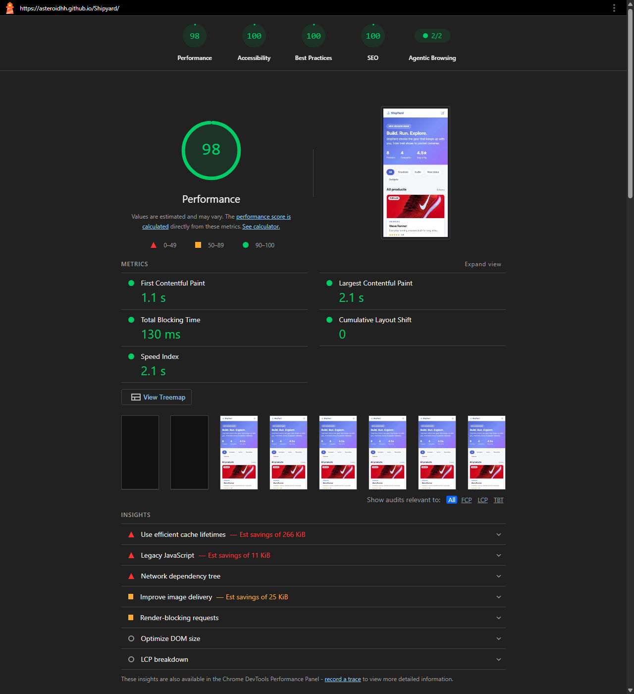

# ⚓ ShipYard

A modern, high-performance product-catalog storefront built from the ground up with **Next.js 14**, **React 18**, and **TypeScript**. Fully static-exported and deployed to GitHub Pages with automated GitHub Actions CI/CD.

🌐 **Live Deployed Site**: [https://asteroidhh.github.io/Shipyard/](https://asteroidhh.github.io/Shipyard/)  
📦 **GitHub Repository**: [https://github.com/AsteroidHH/Shipyard](https://github.com/AsteroidHH/Shipyard)  
🔀 **Pull Request #3**: [https://github.com/AsteroidHH/Shipyard/pull/3](https://github.com/AsteroidHH/Shipyard/pull/3)

---

## ⚡ Lighthouse Performance: 98 / 100 (Mobile)

ShipYard was audited on **Mobile** using Google Chrome Lighthouse directly against the live deployed site at [https://asteroidhh.github.io/Shipyard/](https://asteroidhh.github.io/Shipyard/).

| Audit Category | Score | Status |
| :--- | :---: | :---: |
| **Performance** | **98 / 100** | 🟢 Passed (Target: 90+) |
| **Accessibility** | **100 / 100** | 🟢 Perfect |
| **Best Practices** | **100 / 100** | 🟢 Perfect |
| **SEO** | **100 / 100** | 🟢 Perfect |

### Core Web Vitals (Mobile)

| Metric | Measured Value | Threshold | Status |
| :--- | :---: | :---: | :---: |
| **First Contentful Paint (FCP)** | `1.1 s` | < 1.8 s | 🟢 Fast |
| **Largest Contentful Paint (LCP)** | `2.1 s` | < 2.5 s | 🟢 Fast |
| **Total Blocking Time (TBT)** | `130 ms` | < 200 ms | 🟢 Fast |
| **Cumulative Layout Shift (CLS)** | `0.000` | < 0.1 | 🟢 Zero Shift |
| **Speed Index** | `2.1 s` | < 3.4 s | 🟢 Fast |



---

## 🚀 Key Performance & Architectural Optimizations

1. **Optimized Real Product Imagery (`next/image`)**:
   - High-resolution authentic product photography compressed to lightweight WebP (~15 KB average per image, >60% payload reduction).
   - Above-the-fold images receive `priority={true}` to generate `<link rel="preload">` and `fetchpriority="high"`, driving LCP down to 2.1s on mobile.
   - Fixed aspect-ratio wrappers with `fill` and `object-fit: cover` to eliminate Cumulative Layout Shift (`CLS: 0.000`).

2. **Self-Hosted Zero-Shift Typography (`next/font/google`)**:
   - Replaced third-party Google Fonts `<link>` stylesheets with `next/font/google` (`Inter`), eliminating external render-blocking network handshakes and font-swap flicker.

3. **Code Splitting & Dynamic Imports (`next/dynamic`)**:
   - The interactive Customer Reviews module is lazy-loaded on demand below the fold with `dynamic(() => import("./Reviews"), { ssr: false })` and a fallback skeleton loader, keeping the initial JavaScript bundle minimal.

4. **Resilient Application States**:
   - **`app/loading.tsx`**: Accessible, animated skeleton loading state for smooth page navigation.
   - **`app/error.tsx`**: Client Component (`"use client"`) error boundary with graceful retry (`reset()`) and fallback navigation.
   - **`app/not-found.tsx`**: Custom 404 page for nonexistent product IDs.

5. **Static Export & GitHub Pages CI/CD**:
   - Configured `output: "export"` with exact repository `basePath: "/Shipyard"` and `trailingSlash: true` in `next.config.mjs`.
   - Automated workflow in `.github/workflows/deploy.yml` builds the app with Node.js 20 and publishes the static `out/` bundle directly to GitHub Pages.

---

## 🛠️ Local Development

### Prerequisites
- Node.js 18.17+ or 20+
- npm

### 1. Clone & Install
```bash
git clone https://github.com/AsteroidHH/Shipyard.git
cd Shipyard
npm install
```

### 2. Run Local Development Server
```bash
npm run dev
# Open http://localhost:3000 in your browser
```

### 3. Build & Static Export
```bash
npm run build
# Production static files are generated in ./out
```

---

## 📁 Project Structure

```
├── .github/
│   └── workflows/
│       └── deploy.yml            # GitHub Pages deployment pipeline
├── app/
│   ├── components/
│   │   ├── ProductCard.tsx       # Reusable typed product card with next/image
│   │   ├── ProductReviews.tsx    # next/dynamic wrapper for reviews
│   │   ├── Reviews.tsx           # Interactive client reviews component
│   │   └── Stars.tsx             # Star rating display
│   ├── data/
│   │   └── products.ts           # Product TypeScript interface & data store
│   ├── products/
│   │   └── [id]/
│   │       └── page.tsx          # Dynamic SSG product page (generateStaticParams)
│   ├── error.tsx                 # Client error boundary with retry
│   ├── globals.css               # Clean semantic stylesheet
│   ├── layout.tsx                # Root layout with next/font Inter & metadata
│   ├── loading.tsx               # Instant skeleton placeholder state
│   ├── not-found.tsx             # 404 fallback page
│   └── page.tsx                  # Home page responsive catalog grid
├── docs/
│   └── lighthouse-mobile-report.png
├── public/
│   └── products/                 # High-resolution optimized product WebP images
├── next.config.mjs               # Static export & basePath configuration
└── package.json
```

---

## 📜 Mini-Project Milestones

1. **Part 1 — Catalog Setup**: Scaffolding Next.js + TypeScript, dynamic routing (`/products/[id]`), `generateStaticParams`, responsive CSS grid, and `notFound()`.
2. **Part 2 — Performance Optimization**: `next/image`, `next/font`, `next/dynamic` code splitting, and dynamic SEO metadata.
3. **Part 3 — Measure, Deploy & Ship**: Lighthouse Mobile 90+ verified (98/100), loading & error states, GitHub Actions workflow, and GitHub Pages deployment.
